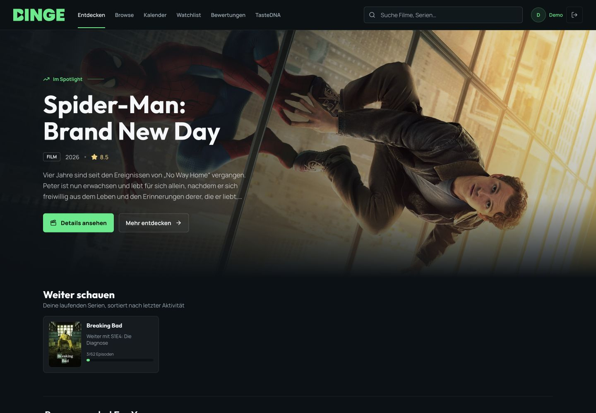
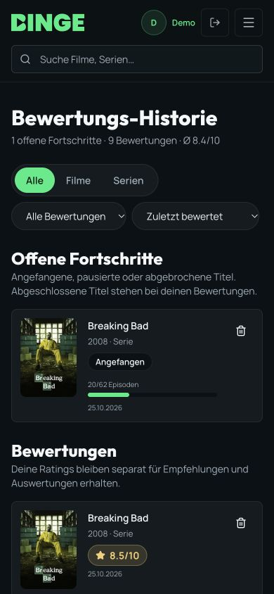

# BINGE

A full-stack movie and TV discovery platform with episode tracking, independent season ratings and explainable taste-based recommendations.

**Stack:** React 19, TypeScript, Vite, TanStack Query, Express 5, GraphQL Yoga, MongoDB/Mongoose and Redis-backed rate limits.



<details>
<summary>Mobile viewing history</summary>



</details>

## Portfolio Demo

Open `/demo` and select **Demo starten**. No shared password or registration is needed. Each visitor gets a separate temporary account with a sample watchlist, ratings and an in-progress series. Changes remain private to that visitor. Demo accounts have no admin privileges and their ratings are excluded from real community signals.

Demo sessions expire after 24 hours by default; MongoDB TTL indexes subsequently remove their personal documents. Normal user records do not have demo expiry fields.

- [Free deployment guide, in German](docs/deployment-free.md): publish the real full-stack application on Render Free with Atlas Free. No public URL has been provisioned by this repository.
- [Architecture and engineering decisions](docs/architecture.md)
- [Security review and remaining commercial-launch work](docs/security-review.md)
- [Third-party data and asset notices](THIRD_PARTY_NOTICES.md)

For a local demonstration without touching an existing database:

```sh
npm ci --legacy-peer-deps
npm run demo:preview
```

The isolated preview is available at `http://127.0.0.1:4100/demo`. It uses an ephemeral local MongoDB instance and a separate development cookie, and still needs a server-side TMDB key in `.env`. The first run downloads the official MongoDB binary; stopping the preview removes its temporary database.

## Main Workflows

- Search and filtered discovery with incremental loading, original-language and Austrian streaming-provider filters.
- Per-episode/per-season viewing progress, next available episode and Continue Watching.
- Half-star movie and season ratings; the series rating is calculated from rated seasons.
- Watchlist, viewing history and ratings with user-scoped persistence.
- TasteDNA: an explainable heuristic combining content preferences and community/similar-user signals. It is not a trained machine-learning model.
- Role-protected release-calendar administration, separate from the public demo.

## Development

Use a currently patched Node.js 22 LTS release, at least 22.15 (`nvm use` selects the local version for the 22 branch).
Install with `npm ci --legacy-peer-deps`, configure a local `.env` using the keys in `.env.example`, then run `npm run dev`.
The frontend is served on port 8080 and proxies `/api` and `/graphql` to the API on port 4000.
Existing credentials belong only in the environment or a secret manager.

```sh
npm run typecheck
npm run check:api
npm test
npm run test:integration
npm run build
npm run lint
```

`npm test` uses isolated HTTP servers and mocked session persistence. It does not create accounts or delete data in the configured MongoDB database.
`npm run test:integration` builds the application and starts its own local MongoDB test server. Alternatively, explicitly set `TEST_MONGODB_URI` for a disposable test instance. The regression tests create/remove their own random test database or temporary collection; they never use the application's normal ratings collection. The metadata server is stubbed locally, so integration tests need no real TMDB key.
GitHub Actions runs API-type freshness, zero-warning lint, typecheck, production build, tests including real MongoDB regression flows, and a high-severity dependency audit. This workflow contains no application credentials.
The older root-level `test-*.mjs` scripts are manual probes, some of which create real database records. They are deliberately not part of the automated test command; use a disposable database for them.

## Code Organization

- `shared/catalog.ts`: domain enums, Austrian market, provider catalog and release labels shared by frontend and backend.
- `shared/auth.ts`: shared registration validation and password policy.
- `server/config.ts`: validated runtime settings and production prerequisites.
- `server/db/models.ts`: Mongoose schemas, model types and indexes. Existing collection names are preserved.
- `server/auth.ts`: the single authentication service used by both REST and GraphQL.
- `server/http/app.ts`: HTTP middleware, origin checks, rate limits, error handling and Yoga setup.
- `server/graphql/schema.ts`: public GraphQL contract.
- `shared/api.generated.ts`: schema-derived API and resolver types. Run `npm run generate:api` after changing the schema; `check:api` detects drift.
- `server/graphql/limits.ts`: request and query resource limits.
- `server/services/metadata.ts`: bounded, coalesced upstream requests and public metadata cache.
- `server/services/social-match.ts`: community aggregates and similar-user selection.
- `server/services/discover.ts`: shared discover/filter parameter construction.
- `server/demo/`: isolated demo identities, fictional personal fixtures and seed service.
- `server/server.ts`: application composition and existing title, viewing, release and recommendation resolvers.
- `src/hooks/use-media-suggestions.ts`: the shared autocomplete query with debounce, cancellation and query caching.
- `src/lib/query-invalidation.ts`: viewing changes invalidate related screens in one place.
- `src/lib/auth-provider.tsx` and `src/lib/auth-context.ts`: authentication provider and stable context/hooks, separated for reliable hot reload.
- `src/lib/media-assets.ts`: image URL helpers shared independently from React components.
- `src/App.tsx` and `src/components/RouteBoundary.tsx`: route-level code splitting with loading and recoverable error states.

Add tunable operational limits to `server/config.ts`; put stable domain choices in `shared/`.
Upstream URLs, protocol constants, enum values and recommendation policies are intentional domain definitions, not deployment secrets. Do not move every literal into environment variables.
Keep user-owned reads and writes behind `authorizeUser`; administrative writes require `requireAdmin`.
Cache only public metadata globally. Keep personalized results out of public/CDN caches, and invalidate viewing-dependent queries after mutations.
Use concrete types or validate `unknown` at boundaries. GraphQL resolvers use generated argument, context and response types; external TMDB responses have explicit transport types. React hooks/context and shared UI variants are separate from component modules for predictable hot reload.

## Production

1. Replace the MongoDB password and TMDB/OMDb keys previously present in the tracked example file. Removing them does not remove them from Git history or copies.
2. Set `NODE_ENV=production`, exact HTTPS `APP_ORIGINS`, `MONGODB_URI`, `REDIS_URL` and `TMDB_API_KEY`. Configure `HOST` for your hosting environment. MongoDB and Redis must use private/authenticated connections in production.
3. Build with `npm run build`. Run `npm run db:indexes` once during deployment before starting traffic. This command creates declared indexes and migrates the obsolete title-only rating uniqueness constraint to the season-aware constraint. It verifies the replacement before removing only the obsolete rating index; it never calls `syncIndexes` or deletes records. Review any duplicate-index error rather than deleting existing data.
4. Start the compiled API with `npm start`. For a single-origin deployment, set `SERVE_WEB=true`: Express serves `dist/`, including direct SPA links, static asset caching and the application CSP. Alternatively use a separate frontend host/CDN and proxy `/api` and `/graphql` to the API; that host must apply appropriate security headers too.
5. Configure `TRUST_PROXY` only for the actual hosting topology. The Render template explicitly trusts one reverse-proxy hop. Do not copy that setting to an environment with a directly reachable backend or alternate-length proxy paths.
6. Use `/health` for liveness and `/ready` for MongoDB/Redis readiness. Configure alerts, request logs without credentials, backups and tested restores.

Redis stores shared rate limits across API instances. Development uses a local in-memory rate-limit store when Redis is absent; production requires Redis and does not fail open on store errors.
Metadata and similar-user caches are bounded per process; they are not a distributed response cache.

`render.yaml` is the portfolio template: Free web + Free Key Value, private demo database, demo enabled, public registration disabled and startup index preparation enabled. On Render, `APP_ORIGINS` can use the platform-provided `RENDER_EXTERNAL_URL`; other hosts need explicit origins. Production demo access remains opt-in outside this template. See [the deployment guide](docs/deployment-free.md) before granting hosting access or entering secrets.

The session migration creates a `sessions` collection with unique token hashes and a TTL index. Existing watchlists, ratings, episode progress and roles are preserved. Previous JWT cookies no longer authenticate; users sign in again. A valid session is revoked on logout, and privileges are read from the database rather than cookie claims.

For older databases that reject a second season rating, run `npm run db:migrate:ratings`. The idempotent migration creates and verifies unique `(userId, tmdbId, mediaType, seasonNumber)` keys before removing the obsolete unique `(userId, tmdbId, mediaType)` index. No ratings are changed or removed; per-season ratings and the series aggregate can coexist.

To assign a role to an existing account, use the controlled server-side maintenance command:

```sh
npm run user:role -- --email admin@example.com --role ADMIN
```

Public registration always creates `USER` accounts. `ADMIN_EMAILS` and an insecure fallback JWT secret are no longer authentication mechanisms.

Read [the security and scalability review](docs/security-review.md) before opening public registration.
