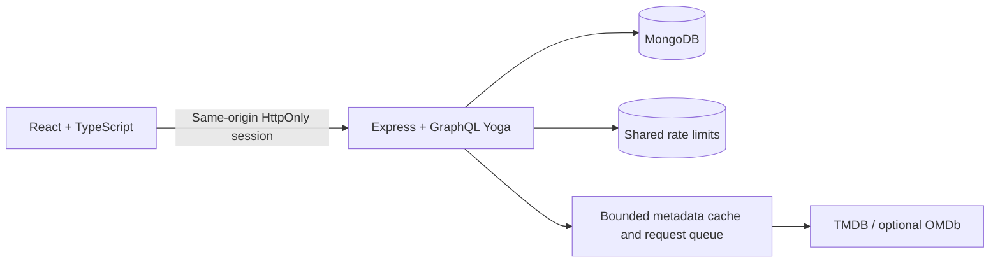

# Architecture and Engineering Decisions

## Request Path

The portfolio deployment serves the compiled frontend and API from one origin. This preserves the existing cookie-based authentication without third-party cookies or a second frontend proxy. React Query owns client caching and invalidation; route bundles load on demand.

## Contracts

`server/graphql/schema.ts` is the GraphQL source of truth. `npm run generate:api` generates concrete API and resolver contracts in `shared/api.generated.ts`; CI checks that they match the schema. Nullable output fields remain explicitly nullable, input nullability is handled at the resolver boundary, and TMDB transport types live separately from frontend view models.

Authentication, HTTP policy, schemas/models, external metadata, discovery filters and social scoring have separate modules. `server/server.ts` still groups substantial domain/resolver composition; gradual extraction into tested domain services is preferable to an unrelated rewrite.

## Viewing and Ratings

Ratings, watchlist entries, title progress and episode progress are distinct collections. Rating a movie also records completion and removes it from the watchlist, but watching a movie does not require a rating. Episode and title ownership always derives from the authenticated session, never an unchecked client user ID.

Season ratings have unique `(userId, tmdbId, mediaType, seasonNumber)` keys; a `null` season is the aggregate series rating. A targeted index migration replaces the older title-only constraint only after the season-aware replacement is verified. It never removes rating documents. The browser serializes rating mutations within an account and lets the backend own the viewing side effects, avoiding duplicate mutation requests.

Multi-document writes are not yet a transactionally guaranteed commercial workflow. Failures between rating/progress/watchlist writes still require transaction support or reconciliation for a production-scale launch. This limitation is deliberately visible rather than hidden behind a green build.

## Demo Isolation

`POST /api/demo` issues a random, visitor-specific identity and a normal server-side session. No public password or privileged account is embedded in the frontend. Repeat requests from a valid demo session reuse it; an authenticated real account cannot silently be switched into a demo.

The demo ID includes a fixed expiry and a random UUID. It is an identifier, not a credential: authentication still requires the independent opaque session cookie. Only a stored, unexpired session can resolve a demo identity. The server always assigns the `USER` role and explicitly rejects demo admin access.

All demo personal documents receive `demoExpiresAt`. The same expiry propagates when visitors rate additional titles, mark episodes or rebuild their taste profile. MongoDB TTL indexes perform eventual cleanup; session checks enforce expiration immediately. Normal accounts have no demo expiry, and demo ratings are excluded from community and neighbor aggregates. Public metadata can be cached globally; personalized caches remain client/user scoped.

## Reliability and Security

- Random session tokens, SHA-256 hashes at rest, HttpOnly cookies and logout revocation.
- Exact API origins, Fetch Metadata checks and JSON-only mutations. External top-level links to the frontend remain allowed.
- Shared Redis-backed authentication/API/demo throttles in production; bounds on GraphQL depth, cost, aliases, root fields, input lists and body size.
- Bounded LRU metadata caches, duplicate-request coalescing, finite queues and upstream timeouts.
- Startup configuration validation, explicit index preparation, readiness checks and graceful shutdown.
- Redis/metadata failures do not justify removing authentication or disabling rate-limit safeguards.

## Verification

`npm run test:all` checks API-type freshness, zero-warning lint, types, a production-equivalent test build, backend tests, React component/hook tests and the Playwright browser/API matrix. The database regression suite starts a real temporary MongoDB server and uses local metadata fixtures; it never needs Atlas or real service credentials.

The same browser workflows run in Chromium, Firefox, WebKit and two mobile profiles. They cover authentication and visitor isolation, search, ratings, episode progress, discovery and calendar administration. axe scans, targeted screenshot baselines, failure injection and API contract checks supplement the workflow assertions. Backend execution from integration and browser tests is merged through source maps; targeted component coverage has separate per-file gates. CI retains diagnostic artifacts and rejects flaky retries.

See [the testing guide](testing.md) for the precise scope, commands and limitations. Automated scans, emulated devices and a small local API smoke test are not a production accessibility, security or capacity guarantee.

## Portfolio Versus Commercial Launch

The free deployment is deliberately single-instance and usage-limited. It is suitable for small demonstrations, not an availability or capacity commitment. Email verification/password recovery, privileged-account MFA, transactional viewing changes, very-large-library pagination, broader failure/load tests and independent security review remain future commercial-launch work.
